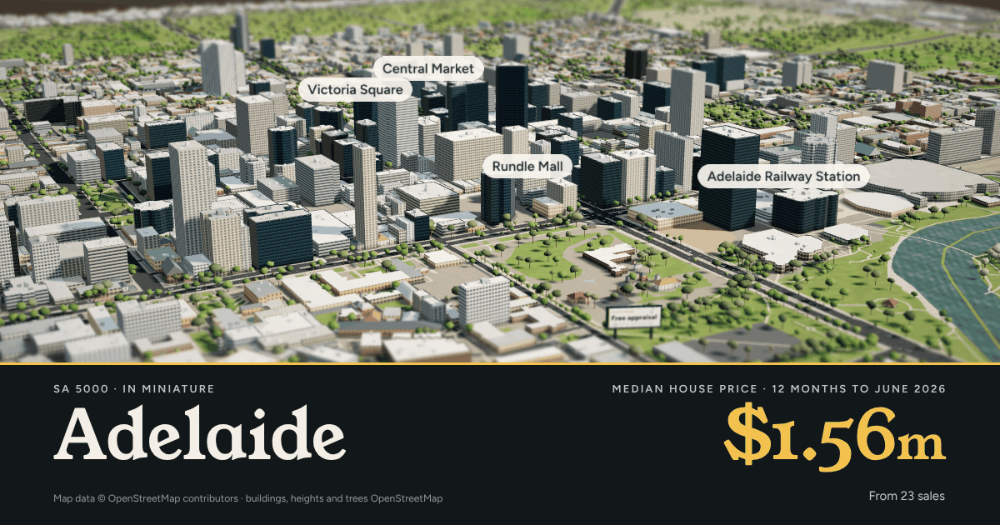
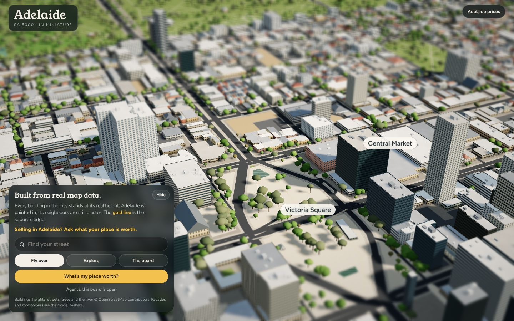
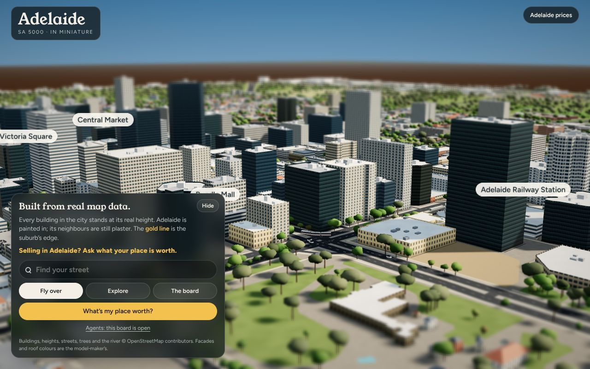
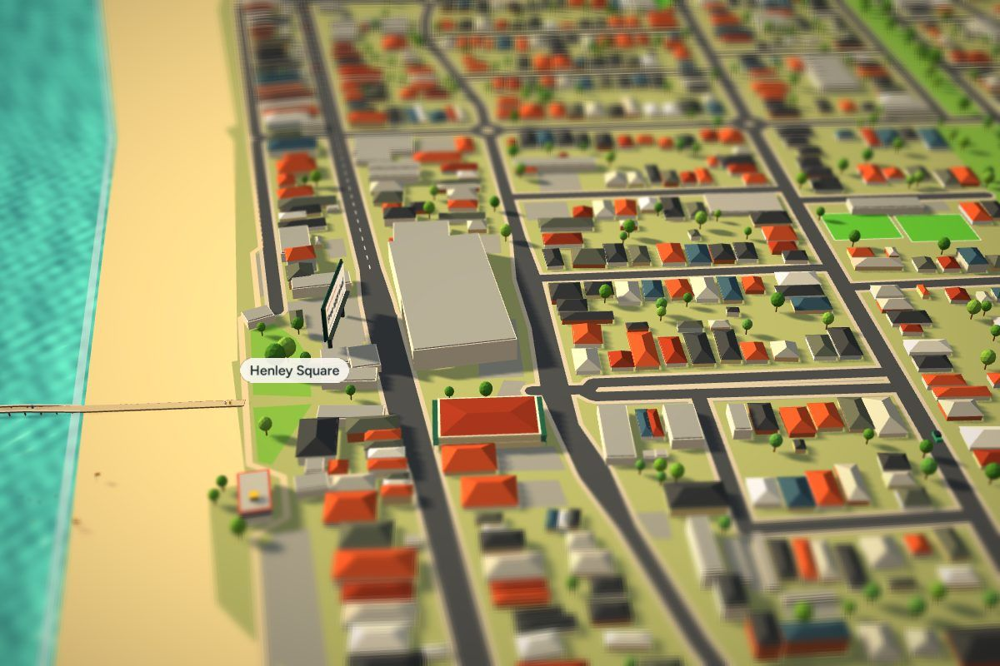

# Adelaide in Miniature: the CBD board (`/adelaide/adelaide/miniature`)

This is the Henley Beach board's format applied to Adelaide 5000, the crown jewel, built to look real. Every building is at its real footprint and real height, on real streets, with the Park Lands, the Torrens Lake and every tree OpenStreetMap has. Trams run down King William Street, trains run out of Adelaide Railway Station, crews row on the lake and riders use the river path. The page works the same way as Henley's: Fly over, Explore, The board, Find your street, What's my place worth?, the slot, the beacon and the fallback card.



| Fly over | North Terrace | West End cottages |
|---|---|---|
|  |  |  |

For comparison, Henley's board: 

## Less cartoony: what changed from Henley's engine

| | Henley (toy) | Adelaide CBD (real) |
|---|---|---|
| Buildings | Boxes with a hipped cap | The real OSM footprint (courtyards included), extruded to its real height |
| Walls | Flat colour | Facades drawn per storey: curtain-wall glass, two kinds of concrete office, apartments with balconies, North Terrace sandstone, brick institutions, shopfronts, cottages, open-deck car parks |
| Glass | — | Reflects the sky (a PMREM environment map) |
| Roofs | Saturated toy colours | Flat roofs behind parapets with plant rooms and lift overruns; tin, Colorbond, terracotta and slate on the pitched ones |
| Colour | Display colour, saturation boosted ×1.24 | Linear light, ACES filmic tone mapping, sRGB out, a near-neutral grade |
| Light | Low sun | Spring afternoon sun in the north-west, so north faces are lit, east faces are in shade, and towers throw long shadows |
| Ground | Flat colour | Noise-textured grass, asphalt and paving; contact shadows where walls meet the ground; olive Park Lands grass |
| Trees | Bright balls on sticks | 11,000 mapped trees at their real spots, plus a sparse fill in the Park Lands: grey-green gums in the parks, plane trees on the streets, lumpy multi-lobed crowns |
| Cars | Red, yellow and blue, oversized | Real size, real fleet colours (mostly white, silver, grey and black) |
| Water | Turquoise | The Torrens' green-brown, reflecting the sky |

The tilt-shift lens, the plaster neighbours and the gold suburb edge are kept: it's still a model on a table. It just looks like a real one.

## Files

```
dist/adelaide/adelaide/miniature/index.html   the page (1.05 MB, 367 KB gzipped): upload to /adelaide/adelaide/miniature
dist/mini/adelaide.jpg                         fallback-card poster (slot.poster)
dist/mini/adelaide-card.png                    og:image / twitter:image (1200×630)
src/page.html  src/engine.js  src/boot.js      page template, engine (Henley's plus the changes above), boot (unchanged)
engine-from-henley.patch                       the engine changes as a diff against Henley's live engine, to port into bait
ENGINE-NOTES.md                                what changed and why, the traps, and how to keep an A/B test fair
build/data.js                                  the CBD's D_* data and PLAN
tools/extract_cbd.py                           OSM → build/data.js (stdlib; caches Overpass answers in .osm-cache/)
tools/build_page.py                            src/ + build/ → dist/ (stdlib)
```

## Install

1. Upload `dist/adelaide/adelaide/miniature/index.html` so it serves at `https://aldo.today/adelaide/adelaide/miniature`.
2. Upload `dist/mini/adelaide.jpg` and `dist/mini/adelaide-card.png` to `/mini/`.
3. Make sure the server takes the beacon POST at `/adelaide/adelaide/miniature/seen`, as Henley's does.
4. Nothing else is needed. It uses the same `/assets/vendor/three-r128.min.js`, `/assets/vendor/three-r128-mapcontrols.js` and fonts as Henley.

The slot is pre-filled as public, open board. When an agent takes Adelaide, the server fills `bait-slot` the same way it does for Henley.

## Rebuild

```
python3 tools/extract_cbd.py          # fetch OSM (or reuse .osm-cache/) → build/data.js
python3 tools/build_page.py           # → dist/adelaide/adelaide/miniature/index.html
```

The extractor also plans the page:

- **Fly-over:** up and down King William Street from the north-north-east.
- **Traffic:** 18 routes on the named arterials, both ways or one way as mapped.
- **The board:** placed on open Park Lands ground on the river side, clear of buildings and roads, facing the fly-over.
- **Labels:** Adelaide Oval, Victoria Square, Rundle Mall, Adelaide Railway Station, Torrens Lake, Botanic Garden, Central Market.
- **Streets:** 431 named streets for Find your street.
- **Moving things:** the rail yards, trains, the tram line, rowers and cyclists.

## New data fields (format 2, extended)

- `D_FOOT`: real footprints. Each building is `H B k[r] x,z dx,dz … [/ courtyard …]`, joined by `;`. H and B are wall height and base in metres. k is the kind: `g` glass tower, `o` office, `a` apartments, `h` heritage stone, `c` church, `u` institution, `m` shops, `s` house, `p` car park, `x` shed, `z` stadium. r is the roof: `h` hipped, `g` gabled, `d` dome, or empty for flat. The first point is in metres from the origin; the rest are steps.
- `D_TREES`: mapped trees, tree rows and woods, as `x,z …`.
- `D_ROADS`: the code letter now carries the width (`p22 x,z …`). Henley's form still parses.

Heights come from `height`, or `building:levels` × 3.4 m, or a default for the kind. One inconsistent tag was fixed: Australis House is tagged `height=91` with `levels=2`, so the levels are used. Materials aren't in OSM for most buildings, so the facade comes from the building's kind, its height and its name (churches, the North Terrace institutions and heritage names get sandstone). The panel credit says so: *"Facades and roof colours are the model-maker's."*

## Numbers

- **Tray:** 4.56 × 3.90 km, holding the suburb's whole outline plus the plaster neighbours (North Adelaide, Kent Town, Parkside and so on).
- **Buildings:** 8,661 on the tray, 4,425 of them in the suburb (the plaque prints this).
- **Trees:** about 14,000.
- **Triangles:** 1.47 M on desktop, about 0.9 M on phones. Phones get single-lobe tree crowns, a 2048 shadow map and pixel ratio 1.25 at 30 fps, as Henley's do.

## Tested

Tested in headless Chromium against a local copy of the site's assets:

- desktop at 1280 and 1440 wide, and a phone at 390 × 844
- test-mode camera poses, plus a live run of fly-over, Explore, The board and Find your street. The street search adds `?street=` to the ask link.

There were no script errors. The one console line is the beacon POST, which a static file server can't answer. Software rendering is far slower than any GPU, so frame rate couldn't be measured here. Check it on a real phone before announcing it.
