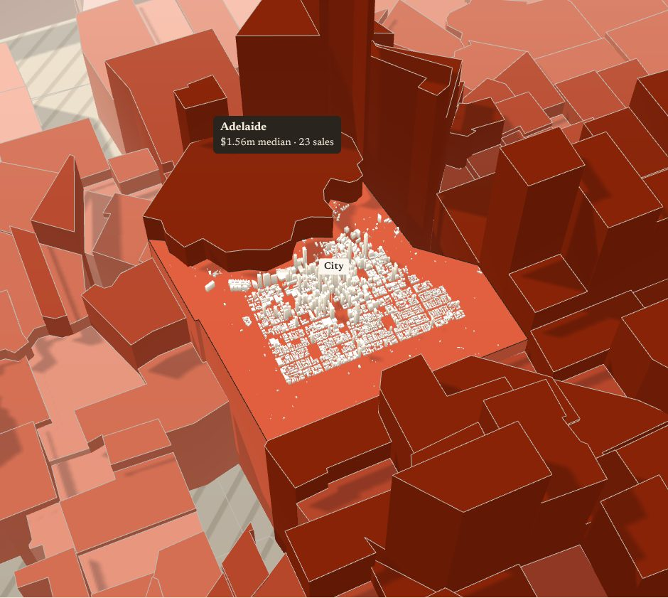
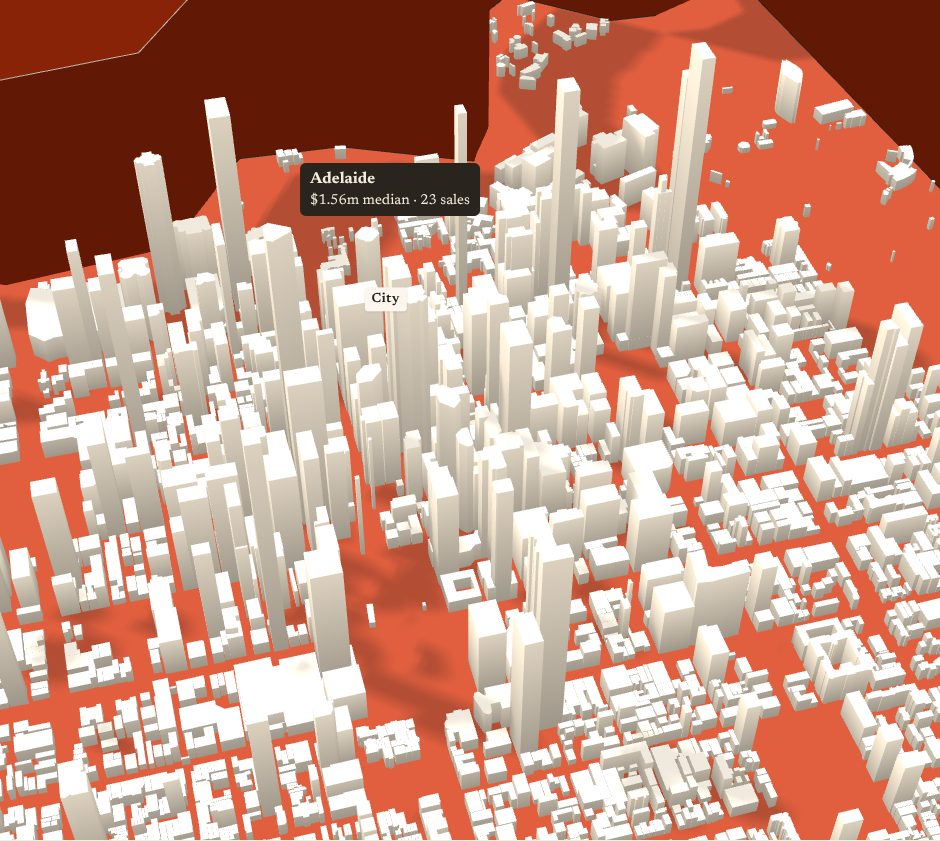

# aldo.today: the CBD in the 3D skyline (v3.43)

On the homepage's 3D map, Adelaide 5000 is no longer a plain block. Every building in the CBD stands on the city's roof as a card model: 4,695 buildings from OpenStreetMap, at their real footprints and four times their real height. The roof is still the tab's number (price, change, land, yield and so on), so the data reading doesn't change. The buildings ride the roof from tab to tab.




## What it does

- **Buildings.** Real OSM footprints with courtyards. Height comes from `height`, else `building:levels` × 3.4 m, else a sensible default for the kind of building. Where a building is mapped as parts (podium plus tower), the parts are drawn.
- **Scale.** 4× vertical (138 m ≈ 10 map units). I tried 3× and 5×: 3× goes flat in the fly-in view, and 5× turns the towers into Manhattan needles.
- **The rise.** The city's roof goes up first, then the buildings grow out of it. On the flat map they don't draw at all, so no white footprints appear.
- **Hover, tap and click.** A building picks as the CBD and lifts with it, and the tooltip sits above the skyline.
- **Find: Adelaide.** Flies in close and steep, over the taller neighbours (North Adelaide and the eastern suburbs), aimed at the roof rather than the ground.
- **Shadows.** When zoomed in, the sun's shadow box closes in on the view, so towers cast real shadows. Zoomed out, the shadow box is the whole city, exactly as before.
- **Light and dark.** Paper-coloured card in light mode, warm off-white in dark mode.
- **Credit.** "Buildings © OpenStreetMap" sits bottom-left while 3D is open (ODbL needs it).
- **No data file?** If `cbd-3d.json` is missing or broken, 3D works exactly as v3.42.

## Install

1. Copy `assets/map3d.js` over the site's `assets/map3d.js`. It is the live v3.42.2 file plus the CBD. `map3d.js.patch` is the same change as a diff, if your source has moved on.
2. Copy `assets/cbd-3d.json` into `assets/`. It is 206 KB, about 65 KB gzipped, and loads only when 3D opens.
3. Append `assets/journal-additions.css` to `assets/journal.css` (the credit pill).
4. Copy `tools/build_cbd.py` into `tools/`.
5. Bump the site version (the `?v=` on the assets) so browsers pick up the new `map3d.js` and the JSON.
6. On `/about-the-data`, add a line: *Buildings in the 3D city: © OpenStreetMap contributors (ODbL).*

## Refreshing the buildings

```
python3 tools/build_cbd.py                     # Overpass + the live homepage's CBD outline
python3 tools/build_cbd.py --page index.html   # or a locally built homepage
```

The script uses the standard library only. It needs the flat map's `data-s="adelaide"` path so it can keep every building on the plate. In the current data only 2 small buildings fall outside, and 13 sheds are under 12 m².

**Projection.** `x = 1604.8242·lon − 222141.2537`, `z = −1962.4464·lat − 67845.4553`, about 56.7 m per map unit. I fitted it to the OSM outlines of eight suburbs (every edge within one unit, the CBD within 0.6). If the map build has its own constants, use those instead.

**One height fix is logged.** Australis House is tagged `height=91` but `building:levels=2`, so the script trusts the levels. Check it on OSM if you know the building.

## Tested

Tested against a local copy of the live homepage in headless Chromium:

- light and dark mode, plus a phone viewport
- every tab (the buildings follow the roof, including the no-data slab on rent yield)
- close and reopen
- reduced motion
- a 404 and a malformed `cbd-3d.json`

There were no console errors. Building the geometry takes 55–140 ms once, before the rise starts. The new shaders compile before the rise too, so there's no hitch mid-animation. The test hook `AtlasMap3D._test.town()` returns `{buildings, top, up, base}` for `tests/map3d_browser.py`.
