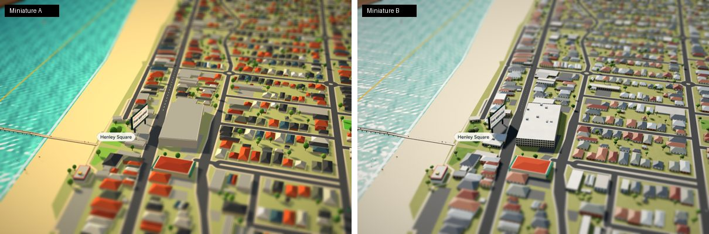
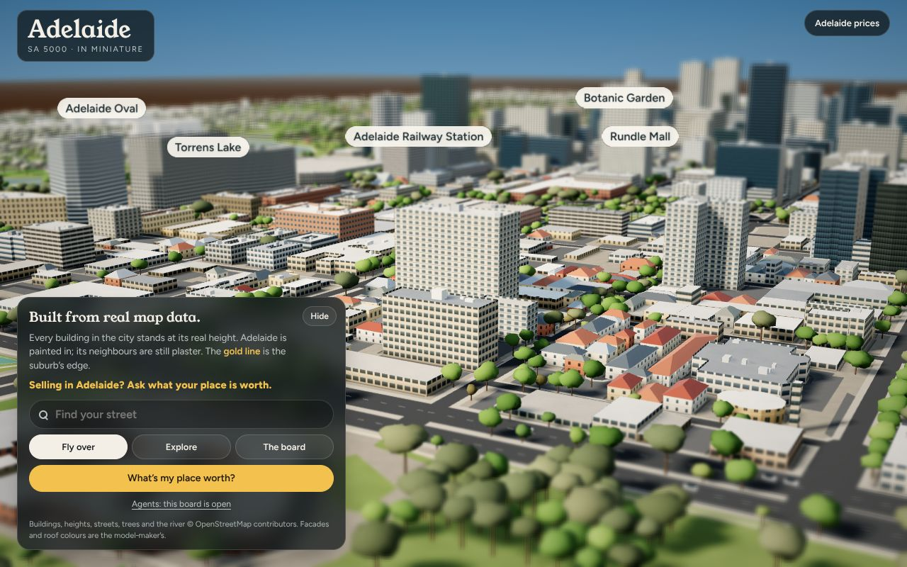

# Miniature B: the realistic boards

**Names:** **Miniature A** is Henley Beach's look (the toy model). **Miniature B** is the realistic look, first made for the CBD. Both use the same page, the same board and the same data format; only the look differs.

This folder builds Miniature B boards:

| Board | URL | What it is |
|---|---|---|
| **Adelaide (CBD)** | `/adelaide/adelaide/miniature` | B only. Every OSM building at its real footprint and height, the Park Lands, the Torrens, 14,000 trees, trams, trains, rowers, riders |
| **Henley Beach** | `/adelaide/henley-beach/miniature` (the B arm) | The **B arm of the A/B test**. Henley's own data, page, words, board and camera, in the B look |




| CBD fly over | North Terrace | West End cottages |
|---|---|---|
|  |  |  |

## Henley Beach in B: the A/B arm

The B arm is built so the look is the only thing that differs. Same as A:

- **Data:** the same data script (Overture/OSM boxes, streets, sea, jetty, the surf club and the Ramsgate Hotel).
- **Page:** the same template, panel words, board, labels, fly path and camera range.
- **Content:** the same 2,355 buildings in the suburb, and A's road widths and footpaths.
- **Trees and cars:** A's planting. B draws its random numbers exactly as A does, so trees and cars stand where they do in A.
- **Weight:** 267 KB against A's 246 KB.

What changes is only the B look:

- **Buildings:** facades and real roof colours.
- **Pools:** catch the sky.
- **Colour and light:** filmic colour, the north-west sun and contact shadows.
- **Ground and water:** suburban lawns, and a gulf that is pale green over the sand bar and deepens to blue.
- **Trees, cars and people:** B's trees, real car colours, and people on the jetty in ordinary clothes.

Its slot already says `"beacon":"/adelaide/henley-beach/miniature/seen?arm=b"` and `"poster":"/mini/henley-beach-b.jpg"`. Give A's slot `?arm=a` and the two show up apart in the beacon log.

The side-by-side sheet of identical camera poses is at `preview/henley-a-vs-b-views.jpg`.

## Miniature B vs Miniature A: what changes

| | Miniature A | Miniature B |
|---|---|---|
| Buildings | Boxes with a hipped cap | Footprints where the data has them (CBD: real OSM rings and heights); A's boxes where it doesn't (Henley) |
| Walls | Flat colour | Facades drawn per storey: curtain-wall glass, two kinds of concrete office, apartments with balconies, sandstone, brick, shopfronts, cottages, open-deck car parks |
| Glass and water | — | Reflect the sky (a PMREM environment map) |
| Roofs | Saturated toy colours | Flat roofs behind parapets with plant rooms and lift overruns; tin, Colorbond, terracotta and slate on the pitched ones |
| Colour | Display colour, saturation boosted ×1.24 | Linear light, ACES filmic tone mapping, sRGB out, a near-neutral grade |
| Light | Low sun | Spring afternoon sun in the north-west: north faces lit, east faces in shade, long shadows |
| Ground | Flat colour | Noise-textured lawn, grass, asphalt and paving; contact shadows where walls meet the ground |
| Trees | Bright balls on sticks | Lumpy multi-lobed crowns: grey-green gums, fresh plane trees, garden trees, dune scrub |
| Cars and people | Bright primary colours, oversized cars | Real size, real fleet colours; ordinary clothes |

The tilt-shift lens, the plaster neighbours and the gold suburb edge stay in B: it's still a model on a table. It just looks like a real one.

## Files

```
dist/adelaide/adelaide/miniature/index.html          the CBD board (1.05 MB, 367 KB gzipped)
dist/adelaide/henley-beach/miniature/index.b.html    Henley Beach's B arm (267 KB): serve it at Henley's URL to the B half
dist/mini/adelaide.jpg, adelaide-card.png            the CBD's fallback poster and share card
dist/mini/henley-beach-b.jpg                         the B arm's fallback poster
src/engine.js, src/boot.js                           the B engine (Henley's plus the changes above) and boot (unchanged)
src/pages/<suburb>.html, <suburb>.slot.json          each board's page (its words) and slot
build/<suburb>.data.js                               each board's D_* data and PLAN (Henley's is copied from the live A page, untouched)
engine-from-henley.patch                             the engine changes as a diff against Henley's live engine, to port into bait
ENGINE-NOTES.md                                      A vs B: what changed and why, the traps, and how to keep the A/B test fair
tools/extract_cbd.py                                 OSM → build/adelaide.data.js (stdlib; caches Overpass answers in .osm-cache/)
tools/build_page.py                                  src/ + build/ → dist/ (stdlib): `build_page.py adelaide`, `build_page.py henley-beach`
```

## Install

**The CBD:**

1. Upload `dist/adelaide/adelaide/miniature/index.html` so it serves at `https://aldo.today/adelaide/adelaide/miniature`.
2. Upload `dist/mini/adelaide.jpg` and `dist/mini/adelaide-card.png` to `/mini/`.
3. Make sure the server takes the beacon POST at `/adelaide/adelaide/miniature/seen`, as Henley's does.

**Henley's B arm:**

1. Upload `dist/adelaide/henley-beach/miniature/index.b.html` beside A's page. It never overwrites A.
2. Have the server send it to the B half of visitors at the same URL, and keep each visitor on one arm.
3. Upload `dist/mini/henley-beach-b.jpg` to `/mini/`.
4. Make sure the beacon accepts the `?arm=` query.

**Both:** nothing else is needed. They use the site's `/assets/vendor/three-r128.min.js`, `/assets/vendor/three-r128-mapcontrols.js` and fonts, as A does. Slots are pre-filled as public, open boards; when an agent takes a suburb, the server fills `bait-slot` the same way it does for A.

## Rebuild

```
python3 tools/extract_cbd.py            # fetch OSM (or reuse .osm-cache/) → build/adelaide.data.js
python3 tools/build_page.py adelaide     # → dist/adelaide/adelaide/miniature/index.html
python3 tools/build_page.py henley-beach # → dist/adelaide/henley-beach/miniature/index.b.html
```

To put another suburb into B: copy its live A page's data script to `build/<slug>.data.js`, make `src/pages/<slug>.html` and `<slug>.slot.json` from the A page, add the slug to `HAS_A` in `build_page.py`, and build.

The CBD extractor also plans the page:

- **Fly-over:** up and down King William Street from the north-north-east.
- **Traffic:** 18 routes on the named arterials.
- **The board:** placed on open Park Lands ground on the river side.
- **Labels:** 7.
- **Streets:** 431 named streets for Find your street.
- **Moving things:** the rail yards, trains, the tram line, rowers and riders.

## Data fields B adds (format 2, extended; A's files still parse)

- `D_FOOT`: real footprints. Each building is `H B k[r] x,z dx,dz … [/ courtyard …]`, joined by `;`. H and B are wall height and base in metres. k is the kind: `g` glass, `o` office, `a` apartments, `h` heritage stone, `c` church, `u` institution, `m` shops, `s` house, `p` car park, `x` shed, `z` stadium. r is the roof: `h` hipped, `g` gabled, `d` dome, or empty for flat. The first point is in metres from the origin; the rest are steps.
- `D_TREES`: mapped trees, tree rows and woods, as `x,z …`.
- `D_ROADS`: the code letter may carry the width (`p22 x,z …`).
- `PLAN.ground`: the colour of the ground between things. Urban grey for the CBD; suburban lawn when it's absent.
- `PLAN.zoom`: `[min, max]` camera distance. A's `[120, 2600]` when absent.
- `PLAN.fly.dist`, `swing` and `elev`: the fly-over's distance and elevation. A's when absent.

For the CBD, heights come from `height`, or `building:levels` × 3.4 m, or a default for the kind. One inconsistent tag was fixed: Australis House is tagged `height=91` with `levels=2`, so the levels are used. Facades come from each building's kind, height and name, because OSM rarely records materials. The panel credit says so.

## Numbers

| | Buildings in suburb | Trees | Triangles (desktop / phone) |
|---|---|---|---|
| CBD | 4,425 (8,661 on a 4.56 × 3.90 km tray) | 14,056 | 1.47 M / 0.91 M |
| Henley B | 2,355 (A's count) | 1,668 | 0.23 M / 0.16 M |

Phones get single-lobe tree crowns, a 2048 shadow map and pixel ratio 1.25 at 30 fps, as A's do.

## Tested

Tested in headless Chromium against a local copy of the site's assets, on desktop and a 390 × 844 phone:

- **The CBD:** test-mode camera poses, plus a live run of fly-over, Explore, The board and Find your street.
- **Henley:** A and B rendered from identical camera poses. B also loaded on a phone with no errors.

There were no script errors. The one console line is the beacon POST, which a static file server can't answer. Software rendering is far slower than any GPU, so frame rate couldn't be measured here. Check B on a real phone before the test goes live.
